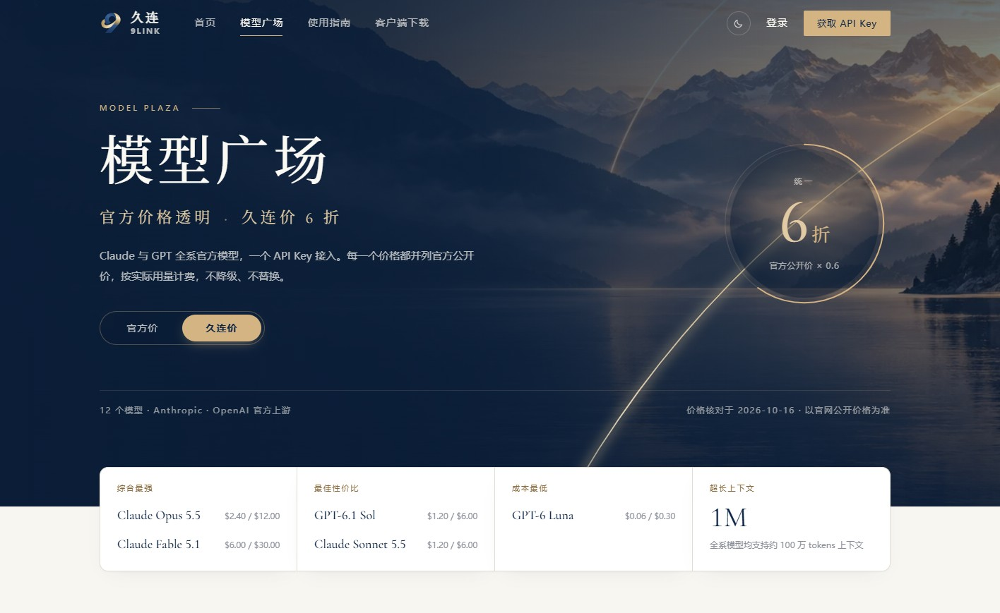
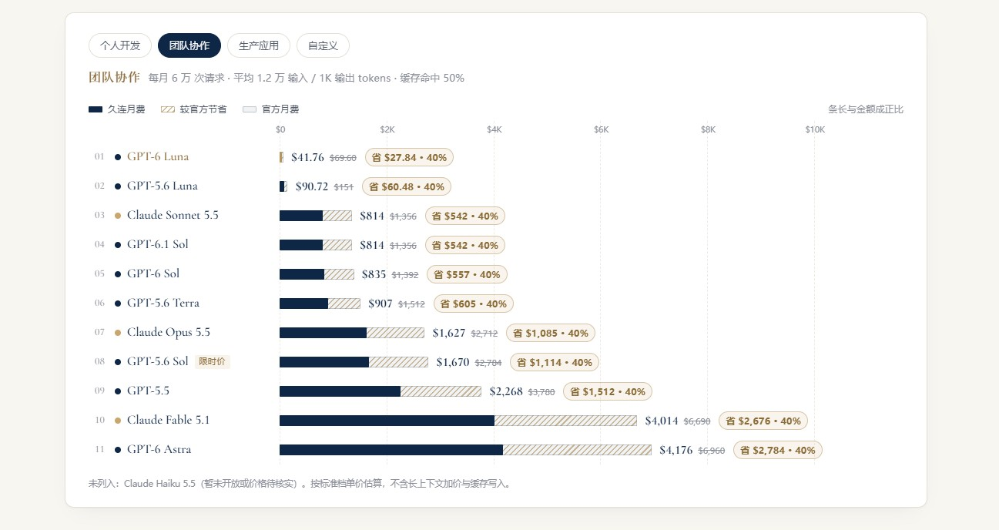
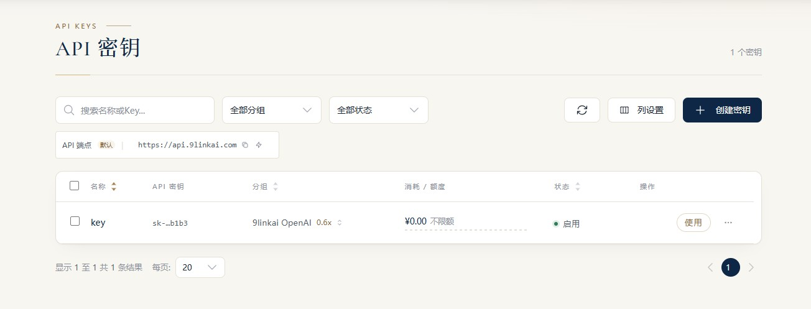

# 2026稳定靠谱的ChatGPT、Claude Code大模型API中转站推荐！全系官方模型6折直连！久连中转站一次接入长久陪伴

## 坚持长期主义的AI大模型中转站

开发者和AI创业团队常常面临一个共同的痛点，寻找一个稳定靠谱不跑路的ChatGPT、Claude大模型API中转站并不容易，大家最怕的就是模型被降级替换、账单不透明，或者服务突然中断，**久连中转站**给出了一个优雅且长期的答案。作为专业的AI模型接入平台，久连致力于让你和团队把精力留给真正重要的事。自此，久连顶尖智慧。

**[立即注册体验](https://9linkai.com/register?aff=BASHIGE)**

久连中转站以长期主义经营每一次连接，提供的不仅是简单的转发服务，更是稳定可靠的长久承诺。用户的每一次请求都会按指定的模型，直接转发至Anthropic与OpenAI官方上游，绝不降级或替换。通过一个API Key，你就能兼容主流SDK与开发工具，即使未来模型迭代，你的接入方式也保持不变，真正实现长久连接。

## 专业高效，账目清晰，为用户降本增效

在专业高效方面，平台实现了输入、输出与缓存的分项计费。每一笔调用的模型、用量与费用均可逐笔查询，彻底告别糊涂账。对于团队而言，久连支持配置独立Key、共享预算与统一结算，让AI能力真正成为组织的长期资产，成就非凡的业务增长。

成本控制在久连这里变得极其透明，坚持明码标价，全系官方模型均享受公开价的**6折优惠**。平台只对实际消耗的tokens计费，输入、输出与缓存读写分项结算，并随官方调价同步更新。虽然标价以美元计算，但余额以人民币结算，扣费时按1USD≈6.90CNY的固定汇率折算，彻底消除汇率波动带来的财务困扰。

这种成本优势在实际应用中尤为明显。以团队协作每月6万次请求、平均1.2万输入与1K输出tokens、缓存命中50%的场景为例。如果使用Claude Sonnet 5.5或GPT-6.1 Sol，久连月费仅需800余美元，相比官方月费可直接节省40%的成本，用量越大，节省的金额就越可观。平台提供12款Anthropic与OpenAI的官方上游旗舰模型，且全系支持约100万tokens的超长上下文，轻松应对海量文档分析与复杂代码库理解。

## API接入简单方便，提供专业技术支持

整个接入过程极为流畅，开发者无需学习新的调用逻辑。你只需要替换Base URL与API Key，现有的代码、SDK与开发工具即可照常运行。无论是流式输出、工具调用还是长上下文，都会按所选模型的能力完整提供。

**[立即注册久连API中转站](https://9linkai.com/register?aff=BASHIGE)**

具体操作上，只需简单四步即可完成。首先注册账户并登录控制台，这里可以一目了然地管理账户余额与用量明细。接着完成充值（支持支付宝、微信付款），余额实时扣减且永不过期。第三步是为不同项目或成员分别创建API Key，并可按需设置额度、有效期与IP白名单，将安全风险降至最低。最后在现有工具中填入久连的地址与Key即可开始调用。例如使用Anthropic SDK时，只需将环境变量ANTHROPIC_BASE_URL设置为久连API地址并填入你的API Key。对于OpenAI兼容工具，同样则将Base URL设置为久连API地址。无论是Claude Code、Codex CLI，还是Cursor、Cline、Roo Code，只要支持配置Base URL的工具都能无缝对接。

## 做全网最专业靠谱的大模型API中转站

A Longer Tomorrow，这不仅是一句口号，更是久连对每一位开发者和企业的承诺。一次接入，长久陪伴。从第一行代码开始，让久连成为你探索AI边界的坚实后盾，把算力转化为真正的生产力。立即获取API Key，开启你的高效AI开发之旅。
